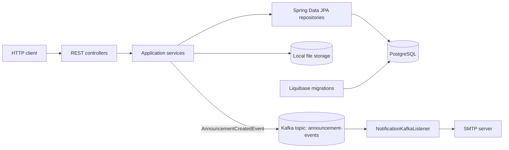

<div align="center">

# 🎓 ClassHub

### Course management, announcements, and event-driven notifications

A Java/Spring Boot backend for an educational platform inspired by Google Classroom.

**Independently designed and developed by [Danil Filippov](https://github.com/blessedchappa30103).**

[](https://openjdk.org/)
[](https://spring.io/projects/spring-boot)
[](https://www.postgresql.org/)
[](https://kafka.apache.org/)
[](https://gradle.org/)

</div>

---

## Overview

ClassHub is a backend application for organizing courses and communication between teachers and students. It provides HTTP APIs for managing users, courses, enrollments, announcements, and file attachments. Announcement creation also produces a Kafka event, which is consumed by an email notification service.

> **Project scope:** The repository contains the Spring Boot backend. A frontend is not included in the supplied source tree.

## Features

- **Users and roles:** Create and retrieve users with `TEACHER` and `STUDENT` roles.
- **Course management:** Create, list, retrieve, archive, and delete courses.
- **Enrollment:** Join courses using a join code, leave courses, remove students, and list active enrollments.
- **Announcements:** Create announcements and retrieve them by course; associate uploaded attachments.
- **File attachments:** Upload files and download them by attachment ID. File metadata is persisted in PostgreSQL; file contents are stored on the local filesystem.
- **Event-driven notifications:** Publish announcement events to Kafka and consume them in an email notification handler.
- **Persistence:** Spring Data JPA/Hibernate with PostgreSQL and Liquibase-managed schema migrations.
- **Authentication foundation:** Spring Security form login and BCrypt password hashing.

## Technology Stack

| Area | Technologies |
| --- | --- |
| Language & build | Java 26, Gradle Kotlin DSL |
| Application | Spring Boot 4.0.7, Spring Web MVC, Bean Validation |
| Security | Spring Security, BCrypt |
| Persistence | PostgreSQL, Spring Data JPA, Hibernate, Liquibase |
| Messaging | Apache Kafka, Spring Kafka |
| Email | Spring Mail, SMTP |
| API documentation dependency | springdoc-openapi |
| Local infrastructure | Docker Compose (PostgreSQL and Kafka) |

## Architecture



The code is organized into controllers, services, repositories, JPA entities, DTOs, security, and configuration. The announcement workflow uses a Kafka producer and consumer rather than sending emails directly from the announcement HTTP request.

### Announcement notification flow

1. A request creates an announcement for a course.
2. `AnnouncementService` publishes an `AnnouncementCreatedEvent` to `announcement-events`.
3. `NotificationKafkaListener` consumes the event.
4. The listener prepares email messages through Spring Mail.

> **Current limitation:** The listener currently overrides the recipient with a fixed test email address. Replace this with `toEmail` before using notifications for real students. Successful delivery also requires valid SMTP credentials.

## API Overview

These routes are defined in the repository's controllers. Most endpoints require authentication under the current Spring Security configuration.

| Method | Endpoint | Purpose |
| --- | --- | --- |
| `POST` | `/api/users` | Create a user |
| `GET` | `/api/users` | List users or search by `username` / `email` |
| `GET` | `/api/users/{id}` | Get a user |
| `GET` | `/api/users/{id}/courses` | Get a user's courses |
| `DELETE` | `/api/users/{id}` | Delete a user |
| `POST` | `/api/courses?teacherId={id}` | Create a course |
| `GET` | `/api/courses` | List courses |
| `GET` | `/api/courses/{id}` | Get course details |
| `POST` | `/api/courses/{id}/join` | Join with a course code |
| `DELETE` | `/api/courses/{id}/leave?studentId={id}` | Leave a course |
| `DELETE` | `/api/courses/{id}/students/{studentId}?teacherId={id}` | Remove a student |
| `GET` | `/api/courses/{id}/students` | List active students |
| `PATCH` | `/api/courses/{id}/archive?teacherId={id}` | Archive a course |
| `DELETE` | `/api/courses/{id}?teacherId={id}` | Delete a course |
| `POST` | `/api/courses/{courseId}/announcements?authorId={id}` | Create an announcement |
| `GET` | `/api/courses/{courseId}/announcements` | List course announcements |
| `POST` | `/api/files/upload` | Upload a multipart file (`file`) |
| `GET` | `/api/files/download/{id}` | Download an attachment |

### Example request bodies

Create a course:

```json
{
  "title": "Introduction to Java"
}
```

Join a course:

```json
{
  "joinCode": "COURSE_CODE"
}
```

Create an announcement:

```json
{
  "content": "The next lecture starts at 10:00.",
  "attachmentIds": []
}
```

## Getting Started

### Prerequisites

- **JDK 26** (configured in the Gradle toolchain)
- Docker with Docker Compose
- SMTP account credentials if testing email notifications

### 1. Clone the repository

```bash
git clone https://github.com/blessedchappa30103/ClassHub.git
cd ClassHub
```

### 2. Start PostgreSQL and Kafka

```bash
docker compose up -d
```

The supplied Compose file exposes PostgreSQL on `localhost:5432` and Kafka on `localhost:9092`. It does **not** containerize the Spring Boot application.

> The Compose configuration uses development-only PostgreSQL credentials (`postgres` / `postgres`). Change them for any shared or deployed environment.

### 3. Configure application secrets

`application.properties` optionally imports `classpath:securityvar.properties` and references these properties:

```properties
sql_username=postgres
sql_password=postgres
mail_username=your-email@example.com
mail_token=your-smtp-app-password
```

For local development, create `src/main/resources/securityvar.properties` with your own values, or supply the properties through your configuration system. **Do not commit real credentials.** Add this file to `.gitignore` if it is not already excluded.

The supplied SMTP configuration targets Yandex SMTP (`smtp.yandex.ru:465`); adjust `spring.mail.*` properties if using a different provider.

### 4. Run the application

On Linux/macOS:

```bash
./gradlew bootRun
```

On Windows:

```powershell
.\gradlew.bat bootRun
```

The configured application port is **8080**. Liquibase is configured to apply database migrations during startup; Hibernate validates the schema.

> **Note:** These instructions are based on the source configuration. A successful end-to-end startup was not verified as part of this README review. Mail configuration and project dependencies may require additional setup or fixes.

### 5. Run tests

```bash
./gradlew test
```

The repository currently includes a Spring Boot context-load test. This is not a claim of comprehensive integration or unit test coverage.

## Project Structure

```text
src/
├── main/
│   ├── java/org/example/classhub/
│   │   ├── config/         # Security and Kafka topic configuration
│   │   ├── controllers/    # HTTP endpoints
│   │   ├── DTOs/           # Request, response, and event records
│   │   ├── models/         # Domain and JPA entities
│   │   ├── repository/     # Spring Data repositories
│   │   ├── security/       # UserDetails implementation
│   │   └── services/       # Business logic and Kafka listener
│   └── resources/
│       ├── application.properties
│       └── db/changelog/   # Liquibase migrations
└── test/                   # Application tests

docker-compose.yaml         # PostgreSQL and Kafka
build.gradle.kts            # Gradle build configuration
```

## Development Notes

This is an evolving educational project. A few areas deserve attention before production use:

- Replace the hardcoded notification recipient with the actual student address.
- Review the Spring Security authorization rules and CSRF settings. CSRF is currently disabled, and controller methods accept user IDs in request parameters; these IDs should not be treated as proof of authorization.
- Expand automated testing beyond application context startup.
- Move development secrets out of tracked files and configure deployment-specific infrastructure settings.

## Author

**Danil Filippov** — independent project design and implementation  
[GitHub](https://github.com/blessedchappa30103)
